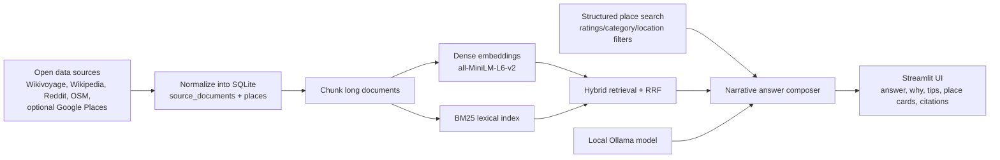

# LocalLens

A local-first RAG assistant for travelers and recent movers. Ask questions like:

- `What should I know before moving to Seattle?`
- `Where is a good sunset spot in San Francisco?`
- `Best taco place in San Jose over 4.5?`
- `Can I rely on public transit in Chicago?`

LocalLens combines open travel guides, local forum threads, structured place records, and optional Google Places enrichment to answer questions with cited, narrative responses.

---

## Architecture



---

## Data Sources

**Default open-source pipeline:**

- `Wikivoyage` — sectioned city/park guide content for activities, transit, food, safety, lodging
- `Wikipedia` — summaries and thumbnail images for orientation and visual context
- `Reddit` — city-subreddit travel/local threads with top comments
- `OpenStreetMap / Overpass` — structured places for restaurants, parks, museums, attractions, hotels, viewpoints, and transit nodes

**Optional enrichment:**

- `Google Places API` — live ratings, review counts, and place metadata
- `NPS API` — national-park metadata

---

## Project Layout

```text
LocalLens/
├── app.py
├── artifacts/
├── data/
│   ├── processed/
│   └── raw/
├── docs/
├── scripts/            # build, eval, profiling, and quantization benchmarks
├── src/locallens/      # retrieval, generation, ingestion, mcp_server.py
├── tests/              # MCP server tests
├── .env.example
├── Dockerfile
├── docker-compose.yml
└── requirements.txt
```

---

## Quickstart

### 1. Install

```bash
cd LocalLens
python3 -m venv .venv
source .venv/bin/activate
python3 -m pip install --upgrade pip
python3 -m pip install -r requirements.txt
```

### 2. Configure environment

```bash
cp .env.example .env
```

The `.env.example` file includes all required values — no API keys needed to get started.

### 3. Run the app

```bash
PYTHONPATH=src streamlit run app.py
```

The database and embeddings are already included in the repo. No rebuild needed.

---

## Local Model Setup

LocalLens uses a local generation model served through Ollama.

```bash
ollama pull llama3.1:8b-instruct-q4_K_M
ollama serve
```

Retrieval embeddings and reranking run locally via:

- `sentence-transformers/all-MiniLM-L6-v2`
- `cross-encoder/ms-marco-MiniLM-L-6-v2`

---

## Performance and Optimization

Retrieval latency was profiled and optimized on the 10-query benchmark (`scripts/run_presentation_eval.py`), measuring before changing anything and keeping results that did not help.

| Change | Result |
| --- | --- |
| Profile the pipeline (`torch.profiler` + stage timing) | BM25 was 74% of retrieval latency; `aten::copy_` (MPS host-device transfers on batch-of-one queries) was 61% of encoder CPU time |
| BM25 inverted index (replaces rank_bm25's full-corpus scan; identical scores) and CPU-pinned query encoder | Mean retrieval latency 62.1 to 10.2 ms/query (6.1x) over 30 runs; BM25 stage 46 to 1.1 ms, encoder 10.0 to 3.5 ms |
| Optional INT8 dense index (per-vector scalar quantization, `LOCALLENS_DENSE_INT8=1`, off by default) | 3.96x smaller (32.4 to 8.2 MB), 100% dense top-10 recall on all 10 benchmark queries, but a 5.6x slower scan because NumPy has no int8 matrix-vector kernel: a memory win only |
| INT8 dynamic quantization of the MiniLM query encoder (rejected) | Weights only 1.55x smaller (dynamic quantization skips the embedding table), 0.85x speed, embedding cosine 0.974 versus FP32 |

After these changes, LLM generation dominates end-to-end latency, so further gains need to come from the generation model (it already runs 4-bit quantized, `q4_K_M`).

Reproduce:

```bash
PYTHONPATH=src python3 scripts/profile_query_pipeline.py        # stage breakdown + torch.profiler trace
PYTHONPATH=src python3 scripts/benchmark_fp32_vs_int8.py        # INT8 dense index vs FP32
PYTHONPATH=src python3 scripts/benchmark_encoder_quantization.py # INT8 encoder vs FP32
python3 scripts/benchmark_embedding_quantization.py             # recall@10 at lower index precision
```

Results are saved under `artifacts/`.

---

## MCP Tool Server

LocalLens can be used as a tool by any MCP client (Claude Desktop, Claude Code, agent frameworks). `src/locallens/mcp_server.py` exposes three tools over stdio:

| Tool | What it does |
| --- | --- |
| `search_evidence` | Hybrid retrieval (BM25 + MiniLM, reciprocal rank fusion) with optional `location` / `topic` filters; returns ranked, cited passages without calling the LLM |
| `ask_locallens` | Full grounded pipeline with citations; abstains when the corpus has no evidence |
| `index_stats` | Corpus size, covered locations and topics, available backends |

Run it: `PYTHONPATH=src python3 -m locallens.mcp_server` (requires `pip install mcp`; included in `requirements.txt`)

Claude Desktop / Claude Code config:

```json
{"mcpServers": {"locallens": {
  "command": "python", "args": ["-m", "locallens.mcp_server"],
  "env": {"PYTHONPATH": "/absolute/path/to/LocalLens/src"}}}}
```

Tests (stubbed service, no index or Ollama needed): `PYTHONPATH=src python3 -m pytest tests/test_mcp_server.py`

## Docker

```bash
# Build
docker build -t locallens .

# Run
docker run --rm -p 8501:8501 \
  -e OLLAMA_BASE_URL=http://host.docker.internal:11434 \
  locallens

# Or with Compose
docker compose up --build
```

---

## Deployment

LocalLens is deployed on a GCP Compute Engine VM with Ollama running on the same instance.

---

## Google Places Support

LocalLens integrates with the Google Places API to enable rating-aware search (e.g. `best taco place in San Jose over 4.5 stars`).

---

## Project Files

| Path | Description |
|------|-------------|
| `data/processed/locallens.db` | Main SQLite database |
| `artifacts/chunk_embeddings.npy` | Dense embedding index (FP32) |
| `artifacts/chunk_embeddings_int8.npz` | Optional INT8 dense index |
| `artifacts/*_results.json`, `profile_*.json` | Benchmark and profiling outputs |
| `src/locallens/mcp_server.py` | MCP tool server |
| `src/locallens/ingestion/` | All ingestion code |

---

## Documentation

- [Project writeup](docs/WriteupLocalLens.pdf)
- [Demo script](docs/demo_script.md)
- [GCP setup notes](docs/gcp_free_tier.md)
```
